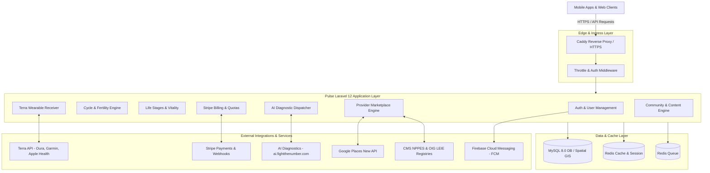
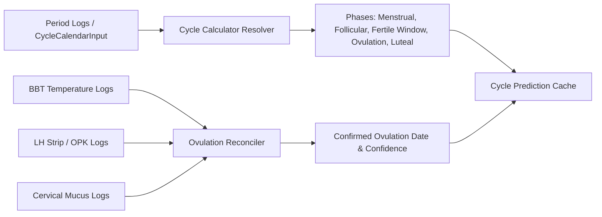
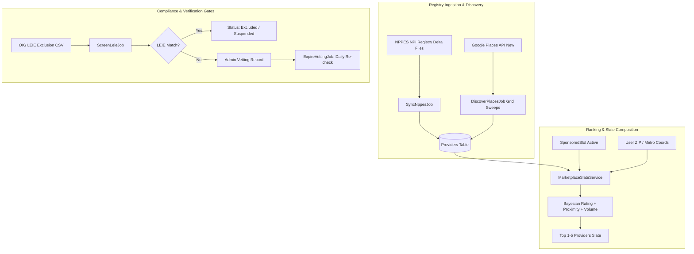
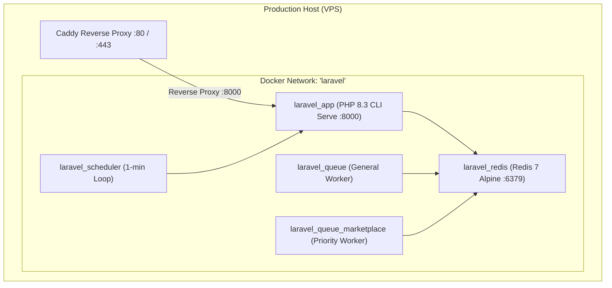

# Pulse / Neumera Backend: Deep Technical Analysis & Architecture Documentation

## 1. Executive Summary

**Pulse** (internally branded as **Neumera**) is an enterprise-grade health, longevity, and reproductive wellness platform built on **Laravel 12** and **PHP 8.2+ / 8.3**. The application serves as the core intelligence engine for mobile and web clients, unifying:

1. **Reproductive Health & Ovulation Intelligence**: Dynamic algorithmic cycle tracking, basal body temperature (BBT) biphasic shift detection, LH surge analysis via OPK (ovulation predictor kit), and cervical mucus reconciliation.
2. **Multi-Life Stage Personalization**: Tailored modules spanning Trying to Conceive (TTC), Avoiding Pregnancy (natural family planning), Pregnancy & Postpartum recovery, Athlete cycle-synced training, and Perimenopause / Menopause care.
3. **Continuous Biometric Wearable Ingestion**: Asynchronous multi-vendor integration (Oura, Garmin, Apple Health, Google Fit, Fitbit) powered by Terra API, featuring automated nighttime vasomotor symptom (hot flash) detection.
4. **AI-Powered Diagnostics & Clinical Interpretation**: Computer vision skin scanning, AI blood lab report interpretation, daily personalized health insights, and conversational wellness agents.
5. **Privacy-Preserving Provider Marketplace**: Geographically scoped, life-stage targeted healthcare provider discovery. Designed with a strict **Zero-PHI (Protected Health Information) boundary**, NPPES registry ingestion, Google Places enrichment, OIG LEIE exclusion screening, Bayesian ranking, and B2B sponsored slot monetization via Stripe.
6. **Commercialization & Community**: Tiered subscription plans, top-up credit management, moderated peer community forums, and blog publication.

---

## 2. Technology Stack & Key Dependencies

| Layer | Technologies & Libraries | Purpose |
| :--- | :--- | :--- |
| **Framework & Language** | Laravel 12.x, PHP 8.2.35 / 8.3 CLI | Application runtime, MVC structure, routing, and job scheduling |
| **Data Storage** | MySQL 8.0+ / MariaDB, Redis 7 (Alpine) | Relational persistence, spatial coordinates, Redis caching & queue backend |
| **Spatial Engine** | `matanyadaev/laravel-eloquent-spatial` (^4.8) | MySQL GIS `Point` geometry, spatial indexes, and distance calculations |
| **Authentication & RBAC** | `laravel/sanctum` (^4.3), `spatie/laravel-permission` (^6.25) | API Bearer token authentication, role and permission gates |
| **Payments & Billing** | `stripe/stripe-php` (^15.0) | Customer checkout sessions, recurring subscriptions, and B2B sponsored slots |
| **Wearables & Telemetry** | Terra API, Guzzle HTTP (^7.9) | Wearable device integration, biometric ingestion, and webhook listeners |
| **Document Generation** | `barryvdh/laravel-dompdf` (^3.1) | Clinical and symptom export PDF generation (e.g., Menopause summary reports) |
| **Queue & Scheduling** | Redis Queue, Laravel Scheduler, Supervisor / Containerized cron | Multi-channel worker queues (`default`, `high`, `marketplace`) |
| **Deployment & Ops** | Docker, Docker Compose, Caddy Reverse Proxy, GitHub Actions CD | Containerized micro-architecture, automated VPS deployments, and SSL automation |

---

## 3. High-Level System Architecture



---

## 4. Deep-Dive Architectural Domains

### 4.1. Authentication, Authorization & Quotas

The application implements a multi-channel authentication model:
- **Email + One-Time Password (OTP)**: Implemented in [`AuthController.php`](file:///C:/Users/Sabbir%20Hossain/Documents/Project/pulse_e_backend_laravel/app/Http/Controllers/User/AuthController.php). Strict `throttle:5,1` rate-limiting guards against brute-force attacks on the 4-digit OTP. Passwords use bcrypt/Argon2 hashing.
- **Federated Identity**: Direct OAuth token verification for **Apple Sign-In** ([`AppleAuthController.php`](file:///C:/Users/Sabbir%20Hossain/Documents/Project/pulse_e_backend_laravel/app/Http/Controllers/User/AppleAuthController.php)) and **Google OAuth** ([`GoogleAuthController.php`](file:///C:/Users/Sabbir%20Hossain/Documents/Project/pulse_e_backend_laravel/app/Http/Controllers/User/GoogleAuthController.php)).
- **Session Tokens**: Laravel Sanctum bearer tokens stored in `personal_access_tokens`.
- **RBAC & Admin Isolation**: Role checks (`admin`, `user`) alongside dedicated guards like [`EnsureUserIsMarketplaceAdmin.php`](file:///C:/Users/Sabbir%20Hossain/Documents/Project/pulse_e_backend_laravel/app/Http/Middleware/EnsureUserIsMarketplaceAdmin.php) protecting administrative marketplace and provider controls.
- **Quota & User Limits**: Implemented in [`UserLimit.php`](file:///C:/Users/Sabbir%20Hossain/Documents/Project/pulse_e_backend_laravel/app/Models/UserLimit.php). Tracks consumption and limits for `skin_scans_limit`, `ai_coaching_limit`, `deep_reports_limit`, and associated top-up balances.

---

### 4.2. Cycle, Fertility & Ovulation Intelligence Engine

The reproductive health engine is one of the project's most sophisticated algorithmic components, located primarily in [`CycleCalculatorService.php`](file:///C:/Users/Sabbir%20Hossain/Documents/Project/pulse_e_backend_laravel/app/Services/CycleCalculatorService.php) (860+ lines) and [`OpkReconciliationService.php`](file:///C:/Users/Sabbir%20Hossain/Documents/Project/pulse_e_backend_laravel/app/Services/OpkReconciliationService.php).



#### Key Logic & Formulas:
1. **Dynamic Parameter Resolution**:
   - Priority hierarchy: Historical `CycleCalendarInput` intervals $\rightarrow$ Recent `MenstrualCycle` logs $\rightarrow$ Aggregated `CycleStatistic` $\rightarrow$ User's custom `CycleSetting` $\rightarrow$ Fallback standard (28-day cycle, 14-day luteal, 5-day period).
2. **Ovulation & Phase Calculations**:
   - Ovulation day is dynamically estimated as: $\text{Ovulation Day} = \text{Cycle Length} - \text{Luteal Length}$.
   - Fertile window spans 5 days prior to ovulation through 1 day post-ovulation (6-day window).
3. **Tri-Signal Ovulation Reconciliation**:
   - **OPK (LH Surge)**: Detects positive/peak LH test ratios ($\ge 1.0$). Expected ovulation is 24–36 hours following the LH surge.
   - **BBT Shift**: Detects sustained thermal rise ($\ge 0.2^\circ\text{F} / 0.1^\circ\text{C}$) over the preceding 6-day baseline (coverline).
   - **Cervical Mucus**: Identifies peak fertile "egg white" or watery consistency.
   - When discrepancies occur (e.g., OPK surge on day 14 but thermal shift on day 17), `OpkReconciliationService` flags confidence ratings and logs discrepancy notes.

---

### 4.3. Multi-Life Stage Modules

1. **Trying to Conceive (TTC)**:
   - Evaluates real-time daily conception probability maps (Low, Medium, High, Peak).
   - Generates surge alerts and personalized timing recommendations via [`TryingToConceiveController.php`](file:///C:/Users/Sabbir%20Hossain/Documents/Project/pulse_e_backend_laravel/app/Http/Controllers/AI/TryingToConceiveController.php).
2. **Avoiding Pregnancy (Natural Family Planning)**:
   - Enforces a mandatory informed consent gate ([`AvoidingPregnancyController.php`](file:///C:/Users/Sabbir%20Hossain/Documents/Project/pulse_e_backend_laravel/app/Http/Controllers/AI/AvoidingPregnancyController.php)) before activating conservative fertile-window avoidance advisories.
3. **Pregnancy & Postpartum**:
   - Managed via [`PregnancyPostpartumController.php`](file:///C:/Users/Sabbir%20Hossain/Documents/Project/pulse_e_backend_laravel/app/Http/Controllers/AI/PregnancyPostpartumController.php).
   - Computes exact gestational age (weeks + days), developmental milestones, fetal size comparisons, and trimester-specific insights.
   - Comprehensive sensitivity controls: Includes empathetic **Miscarriage / Loss Reporting** workflows (halting pregnancy milestone pushes and transitioning the user to emotional recovery support) and smooth transitions into **Postpartum Recovery** (tracking lochia, mood, pelvic floor recovery, and breastfeeding).
4. **Perimenopause & Menopause Care**:
   - Tracks GSM (genitourinary syndrome of menopause) check-ins, sleep disruption, and vasomotor episodes.
   - Uses `barryvdh/laravel-dompdf` to generate clinical summary reports for patient consultations.
5. **Athlete Performance**:
   - Synchronizes physical conditioning with menstrual cycle phases via [`AthletePerformanceController.php`](file:///C:/Users/Sabbir%20Hossain/Documents/Project/pulse_e_backend_laravel/app/Http/Controllers/AI/AthletePerformanceController.php).
   - Advises on high-intensity training during follicular/ovulatory phases versus recovery/endurance emphasis during late luteal phases.
6. **Longevity & Vitality**:
   - Computes long-term mobility scores, preventative health screening schedules, and life arc trajectory curves ([`VitalityController.php`](file:///C:/Users/Sabbir%20Hossain/Documents/Project/pulse_e_backend_laravel/app/Http/Controllers/AI/VitalityController.php)).

---

### 4.4. Wearable Integration & Biometric Telemetry

The platform interfaces with Terra API via [`TerraWebhookController.php`](file:///C:/Users/Sabbir%20Hossain/Documents/Project/pulse_e_backend_laravel/app/Http/Controllers/TerraWebhookController.php).
- Supported hardware: **Oura Ring, Garmin, Apple Watch, Google Fit, Fitbit**.
- Payload ingestion: Daily summary records, activity sessions, sleep intervals, and raw heart-rate / HRV time-series stored in `terra_activity_data`.
- **Automated Hot Flash Detection**: [`VasomotorWearableSyncService.php`](file:///C:/Users/Sabbir%20Hossain/Documents/Project/pulse_e_backend_laravel/app/Services/VasomotorWearableSyncService.php) inspects biometric logs for nighttime heart-rate spikes, sudden skin temperature elevations, and nocturnal awakenings, automatically populating `VasomotorLog` entries for perimenopausal users.

---

### 4.5. AI Diagnostic & Analytics Services

The application delegates intensive deep learning and computer vision tasks to a dedicated external microservice (`ai.fightthenumber.com`):
- **Skin Scan Diagnostics** ([`SkinScanController.php`](file:///C:/Users/Sabbir%20Hossain/Documents/Project/pulse_e_backend_laravel/app/Http/Controllers/SkinScan/SkinScanController.php)): Processes facial selfie images, returning multi-metric scores (overall skin score, acne, hydration, redness, wrinkle index), segmentation masks, and targeted skincare recommendations.
- **Blood Lab Report Interpretation** ([`LabReportController.php`](file:///C:/Users/Sabbir%20Hossain/Documents/Project/pulse_e_backend_laravel/app/Http/Controllers/LabReportController.php), [`ProcessLabReportAI.php`](file:///C:/Users/Sabbir%20Hossain/Documents/Project/pulse_e_backend_laravel/app/Jobs/ProcessLabReportAI.php)): OCR extraction and clinical range classification for uploaded PDF/image lab panels.
- **Smart Analysis & Numera Insights** ([`FetchSmartAnalysisJob.php`](file:///C:/Users/Sabbir%20Hossain/Documents/Project/pulse_e_backend_laravel/app/Jobs/FetchSmartAnalysisJob.php), [`FetchNumeraInsightJob.php`](file:///C:/Users/Sabbir%20Hossain/Documents/Project/pulse_e_backend_laravel/app/Jobs/FetchNumeraInsightJob.php)): Background synthesis of all logged lifestyle and biometric data into actionable summaries.
- **Conversational Wellness Chat** ([`ChatController.php`](file:///C:/Users/Sabbir%20Hossain/Documents/Project/pulse_e_backend_laravel/app/Http/Controllers/ChatController/ChatController.php)): Persistent multi-turn chat sessions with sentiment and mood tracking ([`ProcessMoodAnalysis.php`](file:///C:/Users/Sabbir%20Hossain/Documents/Project/pulse_e_backend_laravel/app/Jobs/ProcessMoodAnalysis.php)).

---

### 4.6. Neumera Provider Marketplace Architecture

The Provider Marketplace connects users with qualified healthcare professionals (OB-GYNs, pelvic floor therapists, dermatologists, reproductive endocrinologists) with guaranteed privacy and clinical integrity.



#### Strict Privacy Boundary (Zero PHI)
- The marketplace API consumes **only** non-identifiable parameters: category slug (`category`), 5-digit ZIP (`zip`) or `metro_id`, and optional high-level `life_stage`.
- **Zero user IDs, zero biometric health metrics, zero symptoms, and zero diagnostic outputs** are ever passed to the marketplace service or provider database queries.

#### Discovery & Registry Sync
- **NPPES Integration**: Downloads weekly CMS delta files to ingest certified National Provider Identifiers (NPIs), taxonomy specialty codes, and business addresses.
- **Google Places Tile Grid**: Expands a metro area's geographic radius using concentric rings and bearing points ([`GooglePlacesClient.php`](file:///C:/Users/Sabbir%20Hossain/Documents/Project/pulse_e_backend_laravel/app/Services/GooglePlacesClient.php), [`DiscoverPlacesJob.php`](file:///C:/Users/Sabbir%20Hossain/Documents/Project/pulse_e_backend_laravel/app/Jobs/DiscoverPlacesJob.php)) to locate matching clinics.
- **OIG LEIE Screening**: Monthly verification against the Office of Inspector General's List of Excluded Individuals/Entities ([`ScreenLeieJob.php`](file:///C:/Users/Sabbir%20Hossain/Documents/Project/pulse_e_backend_laravel/app/Jobs/ScreenLeieJob.php)). Any matched provider is marked `excluded` and blocked from discovery.
- **Mandatory Vetting Pipeline**: Before a provider can reach `active` status, mandatory checks (state medical license verification, LEIE screening, malpractice check) must pass via [`VettingRecord.php`](file:///C:/Users/Sabbir%20Hossain/Documents/Project/pulse_e_backend_laravel/app/Models/VettingRecord.php). If any check expires, [`ExpireVettingJob.php`](file:///C:/Users/Sabbir%20Hossain/Documents/Project/pulse_e_backend_laravel/app/Jobs/ExpireVettingJob.php) immediately downgrades the provider.

#### Slate Ranking Algorithm
Implemented in [`MarketplaceSlateService.php`](file:///C:/Users/Sabbir%20Hossain/Documents/Project/pulse_e_backend_laravel/app/Services/MarketplaceSlateService.php):
1. **Sponsored Tier (Positions 1–3)**: Reserved by vetted, active clinics via [`SponsoredSlot.php`](file:///C:/Users/Sabbir%20Hossain/Documents/Project/pulse_e_backend_laravel/app/Models/SponsoredSlot.php). Double-booking is strictly prohibited by database overlapping-interval constraints.
2. **Organic Ranking**: Uses a weighted multi-factor composite score:
   $$\text{Score} = 0.5 \cdot \text{ProximityNorm} + 0.3 \cdot \left(\frac{\text{BayesianRating}}{5}\right) + 0.2 \cdot \min(\text{ReviewCountNorm}, 1)$$
   Where the Bayesian weighted rating balances low-review outliers against category-wide means:
   $$\text{BayesianRating} = \frac{C \cdot \mu + R \cdot \bar{r}}{C + R}$$
   ($C = 20$ prior weight, $\mu = \text{global mean rating}$, $R = \text{review count}$, $\bar{r} = \text{provider rating}$).

---

### 4.7. Billing & Monetization Infrastructure

The billing module manages two revenue streams via Stripe:
1. **Consumer (B2C) Subscriptions & Top-ups**:
   - Monthly and annual subscription tiers ([`SubscriptionPlan.php`](file:///C:/Users/Sabbir%20Hossain/Documents/Project/pulse_e_backend_laravel/app/Models/SubscriptionPlan.php)).
   - Add-on credit top-ups ([`TopupProduct.php`](file:///C:/Users/Sabbir%20Hossain/Documents/Project/pulse_e_backend_laravel/app/Models/TopupProduct.php)).
   - Webhook handlers ([`SubscriptionController.php`](file:///C:/Users/Sabbir%20Hossain/Documents/Project/pulse_e_backend_laravel/app/Http/Controllers/Subscription/SubscriptionController.php), [`TopupPaymentController.php`](file:///C:/Users/Sabbir%20Hossain/Documents/Project/pulse_e_backend_laravel/app/Http/Controllers/Topup/TopupPaymentController.php)) handle `checkout.session.completed`, `invoice.payment_succeeded`, and `customer.subscription.deleted`.
2. **B2B Sponsored Slots**:
   - Healthcare practices purchase featured marketplace placement.
   - Handled by [`StripeSlotBillingService.php`](file:///C:/Users/Sabbir%20Hossain/Documents/Project/pulse_e_backend_laravel/app/Services/StripeSlotBillingService.php), generating checkout sessions and activating slots upon payment confirmation.

---

## 5. Database Schema & Entity Relationships

```mermaid
erDiagram
    users ||--o{ profiles : has
    users ||--o{ personal_access_tokens : authenticates
    users ||--o{ user_limits : owns
    users ||--o{ payments : executes
    users ||--o{ menstrual_cycles : logs
    users ||--o{ cycle_calendar_inputs : enters
    users ||--o{ period_logs : records
    users ||--o{ bbt_logs : records
    users ||--o{ opk_logs : records
    users ||--o{ cervical_mucus_logs : records
    users ||--o{ terra_connections : links
    users ||--o{ terra_activity_data : transmits
    users ||--o{ skin_scans : takes
    users ||--o{ lab_reports : uploads
    users ||--o{ community_posts : creates
    users ||--o{ user_pregnancies : experiences
    users ||--o{ postpartum_recoveries : tracks

    metros ||--o{ providers : locates
    provider_categories ||--o{ provider_category : categorizes
    providers ||--o{ provider_category : categorizes
    providers ||--o{ place_details_cache : caches
    providers ||--o{ vetting_records : audits
    providers ||--o{ sponsored_slots : reserves
    metros ||--o{ sponsored_slots : limits

    community_posts ||--o{ community_comments : receives
    community_posts ||--o{ community_likes : receives
    community_posts ||--o{ community_post_reports : flags

    skin_scans ||--o{ skin_scan_recommendations : produces
```



### Core Table Summary

| Table | Primary Role & Description |
| :--- | :--- |
| `users` | Core credentials, status flags (`active`, `suspended`), user type, FCM token, Apple/Google IDs. |
| `profiles` | Bio details, dates of birth, life stage linkage, activity levels. |
| `user_limits` | Active quota counters, remaining scan credits, and subscription validity timestamps. |
| `menstrual_cycles` | Cycle starts, ends, confirmed ovulation dates, cycle lengths, and predictive flags. |
| `cycle_calendar_inputs`| Historical start/end inputs entered by the user, powering dynamic period math. |
| `period_logs` | Daily flow tracking, spotting, and blood color indicators. |
| `bbt_logs` | Basal body temperatures, measurement times, and coverline baselines. |
| `opk_logs` | LH test results (negative, positive, peak, test ratio). |
| `cervical_mucus_logs` | Mucus texture (dry, sticky, creamy, watery, egg white). |
| `terra_connections` | Linked wearable accounts, provider names (Oura, Garmin, etc.), auth status. |
| `terra_activity_data` | JSON payloads containing heart rate, HRV, steps, sleep metrics, and skin temperatures. |
| `vasomotor_logs` | Nighttime hot flash incidents and calculated severity ratings. |
| `user_pregnancies` | Active gestation records, due dates, conceived dates, pregnancy loss history. |
| `postpartum_recoveries`| Post-delivery recovery metrics, pelvic floor status, mental health check-ins. |
| `metros` | Geographic market regions, center coordinates (`Point`), and boundary radius in km. |
| `providers` | Healthcare providers, NPIs, Google Place IDs, GIS coordinates (`Point`), match confidence, status. |
| `provider_categories` | Clinical specialties (OB-GYN, Pelvic Floor PT, Dermatology, Midwife). |
| `vetting_records` | Clinical license, LEIE screening, background verification records with `next_due_at`. |
| `sponsored_slots` | Paid placement reservations (slot 1, 2, 3) with start/end validity ranges. |
| `slate_events` | Pseudonymous analytics for impression, tap, website, call, and direction interactions. |

---

## 6. Scheduled Console Jobs & Task Matrix

The application schedules automated cron jobs managed by the dedicated containerized scheduler (`../routes/console.php` and `routes/marketplace_console.php`):

| Frequency | Job / Command | Purpose |
| :--- | :--- | :--- |
| **Weekly (Mon 03:00)** | `SyncNppesJob` | Ingests CMS NPPES practitioner registry delta files to register new clinicians. |
| **Weekly (Sat 03:00)** | `marketplace:discover-places --queue` | Executes concentric Google Places search sweeps across all active metro grids. |
| **Daily (00:00)** | `marketplace:refresh-place-cache` | Rolling 14-day rehydration of ratings, phone numbers, and operational hours. |
| **Daily (00:30)** | `marketplace:purge-place-cache` | Evicts stale place data and dangling Google place IDs. |
| **Daily (01:00)** | `ExpireVettingJob` | Identifies lapsed vetting checks and downgrades affected providers from `active`. |
| **Daily (02:00)** | `RebuildSlateJob` | Precomputes organic Bayesian rankings and caches provider IDs in Redis. |
| **Daily (02:30)** | `marketplace:enforce-slot-integrity` | Audits sponsored slots against provider active status and clears orphan reservations. |
| **Monthly (1st)** | `ScreenLeieJob` | Downloads HHS/OIG LEIE exclusion CSV and excludes flagged NPIs immediately. |

---

## 7. API Route Catalog & Endpoint Reference Matrix

### 7.1. Public & Core Lifecycle APIs

| Method | Endpoint | Description |
| :--- | :--- | :--- |
| `POST` | `/api/v1/register` | User signup with email verification OTP dispatch. |
| `POST` | `/api/v1/login` | Credential validation and token generation. |
| `POST` | `/api/v1/verify-otp` | 4-digit code verification. |
| `POST` | `/api/v1/google/token` | Google OAuth token verification and login. |
| `POST` | `/api/v1/apple` | Apple Sign-In identity token validation. |
| `GET` | `/api/v1/cycle-overview` | Comprehensive cycle, phase, and hormone trend assessment. |
| `GET` | `/api/v1/athlete/unified-performance`| Athletic cycle-sync recommendations and training phases. |
| `GET/POST`| `/api/v1/lifelong-thriving/vitality`| Longevity, vitality scores, and preventative care reminders. |
| `GET/POST`| `/api/v1/pregnancy/summary` | Gestational progress, weekly baby benchmarks, and milestones. |
| `POST` | `/api/v1/pregnancy/report-loss` | Sensitive loss reporting workflow with gentle recovery mode transition. |
| `POST` | `/api/v1/pregnancy/complete-journey`| Seamless transition from pregnancy to postpartum recovery. |
| `GET/POST`| `/api/v1/perimenopause/overview`| Perimenopause symptom tracking, GSM check-in, and insights. |
| `GET` | `/api/v1/perimenopause/export-report`| PDF clinical report export via DomPDF. |

### 7.2. Authenticated Endpoints (`auth:sanctum`)

| Method | Endpoint | Description |
| :--- | :--- | :--- |
| `POST` | `/api/v1/period/log` | Record or update daily menstrual bleeding or spotting. |
| `POST` | `/api/v1/bbt/logs` | Log basal body temperature readings. |
| `POST` | `/api/v1/cycle-engine/opk/log`| Log ovulation predictor strip results and test ratios. |
| `POST` | `/api/v1/cycle-engine/cervical-mucus/log` | Record cervical fluid consistency and fertility quality. |
| `POST` | `/api/v1/skin-scans/analyze` | Submit selfie image for computer vision skin health analysis. |
| `POST` | `/api/v1/lab-reports` | Upload blood work or diagnostic panel for AI interpretation. |
| `POST` | `/api/v1/chat/response` | Send prompt to conversational health advisor agent. |
| `POST` | `/api/v1/subscriptions` | Initialize Stripe checkout session for recurring plans. |
| `POST` | `/api/v1/topup-payment` | Purchase consumable AI / skin scan diagnostic credits. |
| `POST` | `/api/v1/posts` | Create peer community discussion thread. |
| `POST` | `/api/v1/posts/{post}/like` | Toggle like on community post. |

### 7.3. Provider Marketplace APIs

| Method | Endpoint | Auth | Description |
| :--- | :--- | :--- | :--- |
| `GET` | `/api/v1/marketplace/categories` | Public | List provider specialty categories. |
| `GET` | `/api/v1/marketplace/slate` | Public | Returns ranked top 1–5 providers (sponsored + organic). |
| `POST` | `/api/v1/marketplace/events` | Public | Batch ingestion of interaction events (`impression`, `tap`, etc.). |
| `GET` | `/api/v1/admin/providers` | Admin | Search, filter, and review provider registry entries. |
| `POST` | `/api/v1/admin/providers/{id}/status`| Admin | Transition provider status (`candidate`, `active`, `suspended`). |
| `POST` | `/api/v1/admin/providers/{id}/vetting`| Admin | Log license verification or credentialing check result. |
| `POST` | `/api/v1/admin/slots` | Admin | Reserve sponsored slot and create Stripe B2B checkout session. |
| `POST` | `/api/v1/admin/slots/{id}/cancel` | Admin | Cancel active or reserved sponsored slot. |

---

## 8. Security, Privacy & Compliance Controls

1. **Zero-PHI Architecture**:
   - The provider marketplace maintains absolute isolation from clinical user tables. Provider queries use only ZIP/metro geographic data and clinical specialty categories.
2. **Credential & Rate Limiting Defense**:
   - Critical authentication and OTP routes are throttled to 5 attempts per minute.
   - Public marketplace discovery is throttled to 60 requests per minute per IP.
3. **Webhook Cryptographic Signature Verification**:
   - Stripe webhooks verify HMAC signatures against `STRIPE_WEBHOOK_SECRET`.
   - Terra webhooks validate payload integrity against `TERRA_SIGNING_SECRET`.
4. **OIG LEIE Automatic Exclusion Safeguards**:
   - Continuous screening ensures no sanctioned or excluded medical providers ever appear in user recommendation lists.
5. **Data Protection & Soft Deletion**:
   - Sensitive cycle and health logs feature strict ownership authorization checks (`$log->user_id === $request->user()->id`).

---

## 9. DevOps, Containerization & Deployment

The repository includes a battle-tested container architecture configured for zero-downtime VPS deployment:



- **`Dockerfile`**: Builds a lean PHP 8.3 CLI runtime with extensions `pdo_mysql`, `mbstring`, `exif`, `pcntl`, `bcmath`, `gd`, `zip`, and Composer autoloader optimization.
- **`../docker-compose.yml`**:
  - `app`: Exposes port 8000, connected to Redis.
  - `queue`: Worker with `--timeout=3600 --memory=512M` handling long AI pipelines.
  - `queue_marketplace`: Dedicated worker prioritizing `default,high,marketplace` queues.
  - `scheduler`: Runs a 60-second loop executing `php artisan schedule:run`.
  - `redis`: Redis 7 Alpine with integrated container healthchecks.
- **Caddy Web Server Configuration**: Integrated reverse proxy handling Let's Encrypt TLS certificate provisioning and termination.
- **GitHub Actions Workflow**: CD pipeline automating build, push to Docker Hub, SSH triggers, and `docker compose up -d` execution on the production host.

---

## 10. Test Suite & Code Quality Observations

The test suite was executed against the local environment with the following results:

```text
Tests:    131 passed (732 assertions)
Duration: ~29 seconds
```

### Coverage Highlights:
- **`MarketplaceSlateServiceTest` & `MarketplaceSlateEndpointTest`**: Validates Bayesian rating math, proximity weighting, and sponsored slot priority.
- **`ProviderVettingGateTest` & `SponsoredSlotIntegrityTest`**: Confirms that non-vetted or excluded providers can never be activated or hold sponsored slots.
- **`CycleFertilityTest`, `OpkEngineUiTest`, `PeriodLogFlowTest`**: Exercises cycle length calculations, LH surge reconciliation, and spotting log edge cases.
- **`PregnancyPostpartumTest`**: Tests trimester updates, milestone toggling, miscarriage reporting, and postpartum recovery metrics.
- **`PerimenopauseTest`**: Verifies automated wearable telemetry synchronization and PDF report data fidelity.

---

## 11. Recommendations & Production Roadmap

1. **Production Web Server (Nginx / PHP-FPM / Octane)**:
   - The current `Dockerfile` defaults to `php artisan serve`. For production high-concurrency environments, transitioning to **PHP-FPM + Nginx** or **Laravel Octane (FrankenPHP / Swoole)** will substantially increase throughput and reduce memory overhead.
2. **Database Read Replicas & Spatial Partitioning**:
   - As provider geographic data and wearable time-series (`terra_activity_data`) scale, consider table partitioning on `data_generated_at` and MySQL read replicas for read-heavy slate queries.
3. **Queue Monitoring via Laravel Horizon**:
   - Because long-running AI jobs (`ProcessLabReportAI`, `FetchSmartAnalysisJob`) run alongside high-volume tile discovery (`DiscoverPlacesJob`), installing **Laravel Horizon** will provide real-time metrics, queue wait-time alerting, and automatic worker scaling.
4. **Terra Webhook Signature Verification**:
   - Ensure `TERRA_SIGNING_SECRET` signature validation is strictly enabled in production within [`TerraWebhookController.php`](file:///C:/Users/Sabbir%20Hossain/Documents/Project/pulse_e_backend_laravel/app/Http/Controllers/TerraWebhookController.php#L31-L36).
